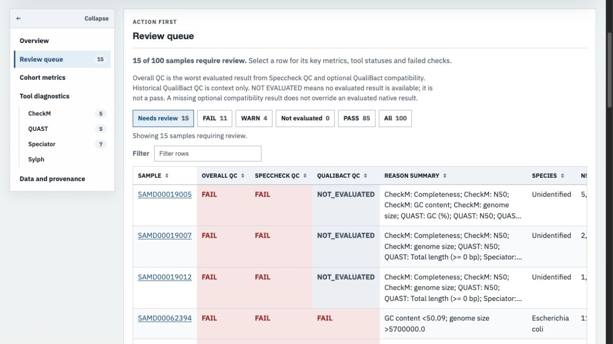
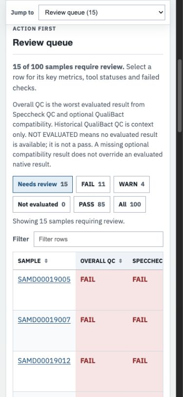

# HTML report validation

Validation performed on 28 October 2026, on macOS with Python 3.11.14.
The canonical repository was verified as `happykhan/speccheck` on GitHub; the
separate GHRU repository migration does not change this repository's remote.

## Defects covered

- Small tables previously ignored text/status filtering: selecting FAIL in the
  two-sample PASS example said zero samples but left both PASS rows visible.
- Sorting used a page-wide heading index, breaking tables after the first table.
- Table search and sorting read rendered text from hidden rows.
- Tool narratives labelled WARN and missing statuses as failures, assumed PASS
  without evidence, or crashed when expected fields were absent.
- Samples without an overall status could disappear from status totals; a
  fallback species label could invent a Speciator diagnostic.
- Table headings and sample rows lacked native keyboard controls; long reasons
  made the mobile queue difficult to scan.

Regression tests cover these behaviours, safe HTML/JSON rendering, partial and
empty direct reports, static mode, missing metric statuses and reason previews.
`tests/report_interactions.cjs` executes the generated inline script with a DOM
double using Node.js. It tests small/paginated tables, combined status/text
filters, empty results, page reset, second-table numeric sorting, `aria-sort`, and
print disclosure restoration. It is separate from the visible browser checks.

## Automated results

The baseline suite passed 121 tests. The final suite passed 153 tests with 88%
overall coverage. Ruff lint and formatting, strict documentation build,
wheel/sdist builds, Twine metadata validation and Bandit passed; Bandit reported
zero issues. A clean environment installed the built wheel and exercised the
version/help commands and mixed-input HTML generation outside the checkout.
The suite emits existing pandas deprecation warnings; no dependency upgrades
were made. The JavaScript regression harness requires Node.js and is skipped
with an explicit reason if Node.js is absent.

## Input provenance and workflow runs

All fixtures were existing repository data or synthetic, with outputs kept
outside the source tree. No upstream sequencing pipeline was rerun.

| Input | Workflow and observed result |
| --- | --- |
| `examples/qualibact_ecoli/pass_only/input` | `summary --plot --qualibact-compat`; 2 PASS |
| `examples/qualibact_ecoli/fail_only/input` | Same command; 2 FAIL |
| `examples/qualibact_ecoli/real_run_100/report/report.full.csv` copied alone into an input directory | `summary --plot --qualibact-compat --xlsx-output …`; 100 samples, 85 PASS, 4 WARN, 11 FAIL; concise CSV identical to the committed example in every column and value |
| Synthetic mixed input | One each of PASS, WARN, FAIL and absent status; summary displays 1 NOT EVALUATED and 3 requiring review |
| Synthetic partial metrics | Incomplete CheckM/QUAST/Speciator/Sylph/ARIBA fields; report renders with NOT EVALUATED |
| Synthetic 300-sample input | 75 of each status; pagination and search across hidden pages checked |
| Synthetic hostile strings | Script-closing sample ID and HTML in species/metric names render as text; detail JSON remains parseable |
| Synthetic static input | `--no-interactive-tables`; all four sample rows present and no buttons |
| Header-only CSV | No report generated; existing command logs no merged data and exits zero |
| Duplicate IDs | Summary rejected with an actionable duplicate-ID error |
| `tests/practice_data/Sample_178db692semb` | `collect` using one explicit file per parser, then `summary --plot`; one FAIL result matching the collected output |

The practice-data directory contains multiple QUAST outputs, so passing the
entire directory is correctly rejected as ambiguous. The successful collection
used `Sample_178db692semb.short (1).tsv` (CheckM),
`Sample_178db692semb.short (2).tsv` (QUAST),
`Sample_178db692semb_slyph_report.tsv` and
`Sample_178db692semb_mlst_report.details.tsv`, with organism `Escherichia coli`,
short assembly mode and the bundled criteria CSV.

The generated HTML detail payload was checked against `report.csv` for sample
IDs and overall statuses for every interactive example. The status totals
accounted for every sample. HTML included no external scripts or stylesheets.

To reproduce the main runs from an installed checkout:

```sh
speccheck summary examples/qualibact_ecoli/pass_only/input --output /tmp/speccheck-pass --plot --qualibact-compat
speccheck summary examples/qualibact_ecoli/fail_only/input --output /tmp/speccheck-fail --plot --qualibact-compat
python -m pytest
ruff check speccheck tests scripts docker/build_docker.py
ruff format --check speccheck tests scripts docker/build_docker.py
python -m build
python -m twine check dist/*
mkdocs build --strict
bandit -r speccheck
git diff --check
```

## Browser checks and limits

Visible checks used the Codex in-app browser on macOS, at its desktop viewport
and a 390 × 844 viewport. Checked status/text filtering, empty results, pagination
(including locating a sample on a hidden page), keyboard sorting in the full
merged table, keyboard opening/closing of sample details, disclosure navigation,
static mode, long reasons and hostile text. No console errors or warnings were
observed on the inspected final pages. Mobile tables scroll within their
containers; the document did not overflow horizontally. The full reason remained
available in the sample dialog after preview truncation.

Reports were served with Python's static HTTP server bound to `127.0.0.1`.
The browser policy blocks `file://` URLs, so direct-file opening was not tested.
Self-containment was checked in generated markup and local serving; an actual
network-disconnected session was not exercised. Print disclosure logic has
regression coverage, but printed-page/PDF layout was not visually verified.
Other browser engines, physical phones and screen-reader software were not
exercised. Screenshot previews show the real 100-sample example.




